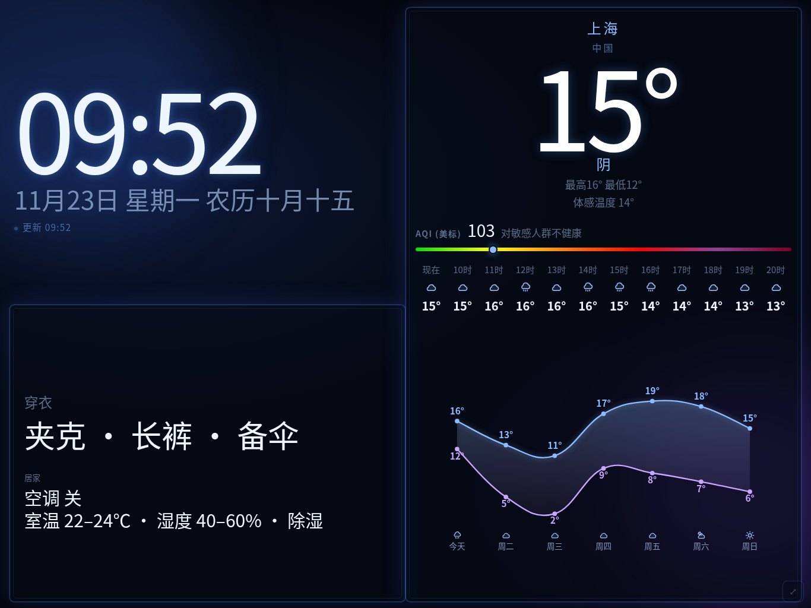
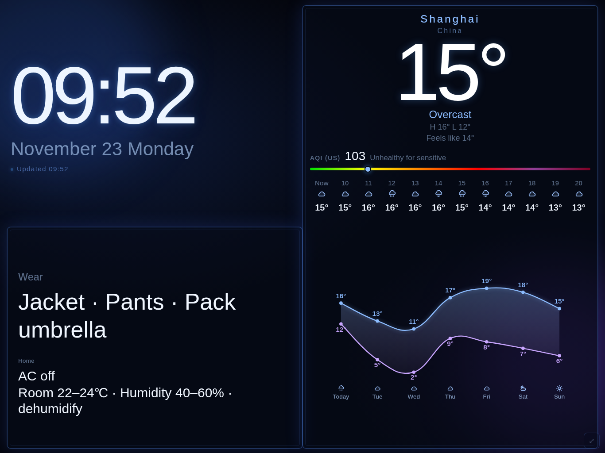
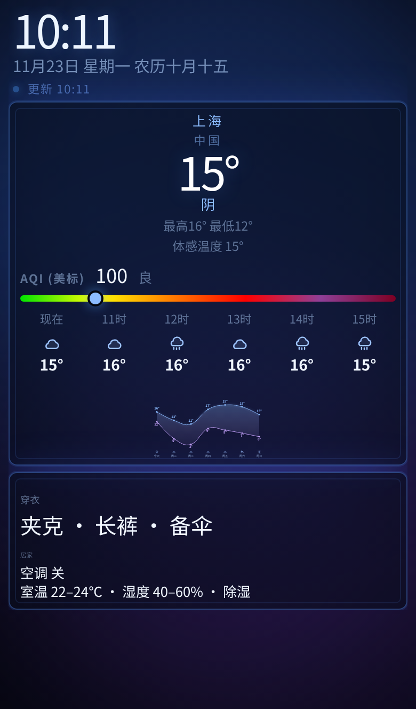

# Weather Clock Dashboard

[中文说明](README.zh-CN.md)

[](https://ywlbest-creator.github.io/weather-clock-dashboard/)

Turn any old internet-connected device — phone, tablet, computer, or smart-TV browser — into a full-screen weather clock: time, forecast, clothing advice, and optional indoor tips. Open it in a browser; no app to install. A single HTML file with no external libraries.







---

## Features

- Full-screen clock, with the current temperature in the same type size; large date and weekday (Chinese UI also shows the lunar date)
- Current conditions, feels-like temperature, air quality (US or European AQI), and an hourly strip
- 7-day high / low temperature curves (plain SVG, no chart library)
- One generic clothing line (no personal names); optional home advice (air conditioner, heater, suggested room temperature and humidity)
- Responsive layout for phones, tablets, computers, and TV browsers; works in landscape and portrait; type scales with the screen
- Written for older iOS Safari and Android Chrome where possible (ES5-style JavaScript, CSS fallbacks)
- Uses the [Screen Wake Lock API](https://developer.mozilla.org/docs/Web/API/Screen_Wake_Lock_API) when available (ignored otherwise); tap the button in the lower-right corner for fullscreen
- Weather refreshes about every 15 minutes; the clock ticks every second
- Full Chinese and English UI: follows `navigator.language` by default, or force it with `?lang=zh` / `?lang=en`. Celsius or Fahrenheit.

Weather data comes from [Open-Meteo](https://open-meteo.com/).

---

## How location is chosen

The page picks a place in this **order** and uses the first step that succeeds:

1. **URL parameters** (highest priority)
   - `?lat=31.23&lon=121.47` uses those coordinates. If `?city=` is also present, the city name is for display only.
   - `?city=Beijing` (or a localized name such as `?city=苏州`) is forward-geocoded with the Open-Meteo Geocoding API.
2. **Browser geolocation** if the URL has no location parameters. The page requests `navigator.geolocation`. After you allow it, weather is fetched for your current position. The place name comes from Open-Meteo reverse geocoding; if that lookup is unavailable, the coordinates are shown instead.
3. **Default city** if you deny permission, geolocation fails, or the device has no geolocation API. The page then uses the default city in the `CONFIG` object at the top of the file (shipped as Shanghai).

On a first visit with no URL location parameters, the browser will ask for location permission. That is expected.

---

## How language is chosen

All on-page text — date and weekday, weather descriptions, clothing and home advice, and labels — is bilingual (Chinese / English).

1. `?lang=zh` or `?lang=en` **forces** the language.
2. Otherwise the page follows `navigator.language` (and `navigator.languages`): tags starting with `zh` use Chinese; any other language uses English.
3. If the browser language is unavailable, `CONFIG.lang` is used (`"zh"` or `"en"`).

---

## Visit count

The badge at the top of this README shows how many times the [live page](https://ywlbest-creator.github.io/weather-clock-dashboard/) has been opened. It uses the same counter as the page itself.

The counter is [Visitor Badge](https://visitor-badge.laobi.icu/) (`visitor-badge.laobi.icu`), a registration-free public service. It only stores a page id and a number, not personal information. The live page records a visit with a hidden request; if that request fails, the dashboard still works as usual. The README badge uses `query_only=true`, so opening this document does not add to the count.

After you fork this project:

- Set `CONFIG.counter` to `false` in `index.html` to turn counting off (you can also remove the badge from the README files).
- Or change `CONFIG.counterId` **and** the `page_id` in both README badges to your own id (for example `yourname.weather-clock-dashboard`) so you start a separate count. Keep `query_only=true` on the README badge if you only want live-page opens counted.

---

## Configuration

Open `index.html` and edit the `CONFIG` object near the top of the file:

| Field | Meaning | Example |
| --- | --- | --- |
| `city` | Default city name (used when location fails, and for the label) | `"Shanghai"` |
| `citySub` | Optional subtitle, such as a district | `"Pudong"` or `""` |
| `lat` | Default latitude | `31.22222` |
| `lon` | Default longitude | `121.45806` |
| `timezone` | [IANA time zone](https://en.wikipedia.org/wiki/List_of_tz_database_time_zones) | `"Asia/Shanghai"`, `"America/New_York"` |
| `lang` | Fallback UI language when the browser language is unknown | `"zh"` or `"en"` |
| `units` | Temperature unit | `"celsius"` or `"fahrenheit"` |
| `aqi` | Air-quality scale | `"us"` or `"european"` |
| `homeAdvice` | Show the home-advice line | `true` / `false` |
| `refreshMinutes` | Weather refresh interval, in minutes | `15` |
| `counter` | Record live-page visits | `true` / `false` |
| `counterId` | Visitor Badge `page_id` (change this after a fork) | `"ywlbest-creator.github.io.weather-clock-dashboard"` |

Clothing advice is a single generic line. There is no household-member or name list in the config.

Reload the page after you edit. On GitHub Pages, commit and push, wait a moment, then refresh.

---

## URL parameter examples

Parameters override the matching `CONFIG` fields. Location priority is described above.

```
?city=Beijing
?city=东京
?lat=40.71&lon=-74.01
?lat=51.51&lon=-0.13&city=London
?lang=en
?lang=zh
?units=fahrenheit
?aqi=european
?home=0
?refresh=10
?tz=America/New_York
?city=New%20York&lang=en&units=f&aqi=us
```

| Parameter | Meaning |
| --- | --- |
| `city` | City name; it will be geocoded |
| `lat`, `lon` | Coordinates |
| `lang` | `zh` or `en` (forces the UI language) |
| `units` / `unit` | `celsius` (or `c`) / `fahrenheit` (or `f`) |
| `aqi` | `us` or `european` (also `eu`) |
| `home` | `0` / `false` / `off` hides home advice |
| `refresh` | Refresh interval in minutes |
| `tz` / `timezone` | Time zone, e.g. `Asia/Tokyo` |

---

## Clothing advice rules

The page shows **one** generic suggestion, with no personal names. It uses the **lowest temperature between 5 a.m. and 8 a.m.** on the focus day, plus precipitation probability. After 18:00, the focus day is tomorrow.

### Tops (morning temperature)

| Temperature (°C) | Advice |
| --- | --- |
| ≥ 28 | Short sleeves |
| 22 – 27 | Light long sleeves |
| 15 – 21 | Light jacket |
| 8 – 14 | Jacket |
| 0 – 7 | Heavy coat |
| < 0 | Down coat |

### Bottoms

| Temperature (°C) | Advice |
| --- | --- |
| ≥ 30 | Shorts |
| 0 – 29 | Pants |
| < 0 | Fleece pants |

### Extras

| Condition | Advice |
| --- | --- |
| Precipitation probability ≥ 40% | Umbrella |
| Probability ≥ 20%, or the weather code is rain | Pack umbrella |
| Morning temperature < 0°C | Hat & gloves |

After 18:00 the label shows “Tomorrow” (or the weekday), and the suggestion is computed for the next morning.

---

## Home advice rules

The home line is estimated from **outdoor** temperature and humidity. It does not read an indoor sensor.

*Floor temperature* is `min(current temperature, overnight low)`. After 18:00, the overnight low is tomorrow’s minimum.

### Air conditioner and heater

| Condition | Advice |
| --- | --- |
| Current outdoor temperature ≥ 28°C | AC cool |
| Floor temperature ≤ 11°C | AC heat |
| Otherwise | AC off |
| (Night **and** floor ≤ 11°C), or floor < 5°C | Also suggest a heater |

Night is 22:00 through 05:30 the next morning.

### Suggested room temperature

| Condition | Room |
| --- | --- |
| AC cool | 26°C |
| AC heat, or outdoor < 15°C | 20–22°C |
| Otherwise | 22–24°C |

### Suggested humidity

The target range is **40–60%**.

| Condition | Extra hint |
| --- | --- |
| Heating and outdoor relative humidity < 50%, or otherwise < 40% | Humidify |
| Heating and humidity ≥ 85%, or otherwise > 70% | Dehumidify |

If the display unit is Fahrenheit, room-temperature figures are converted to °F. The rules themselves still use Celsius.

---

## Using it on different devices (and keeping the screen on)

The page requests a Screen Wake Lock when the browser supports it, and ignores the API otherwise. Also turn off auto-lock in system settings. Tap the lower-right button to enter fullscreen (some mobile browsers do not allow web fullscreen — use “Add to Home Screen” instead).

### iPhone / iPad (Safari)

1. Open the page in Safari.
2. Tap the Share button, choose **Add to Home Screen**, then open it from the home screen so the browser chrome is hidden.
3. Go to **Settings → Display & Brightness → Auto-Lock** and choose **Never** (this uses more power; change it back later).
4. You can also use Guided Access to keep the device in this app.

iOS support for web Wake Lock is limited. Prefer the system Auto-Lock setting.

### Android phones and tablets (Chrome and similar)

1. Open the page in Chrome, then use the menu **Add to Home screen** or **Install app**, and open it from the home screen.
2. In **Settings → Display → Sleep / screen timeout**, choose a long interval or **Never** (the label varies by manufacturer).
3. Some devices offer **Stay awake** in developer options. Recent Chrome usually honors Wake Lock while the page is visible.

### Computers (Windows / macOS / Linux)

1. Open the page in Chrome, Edge, or Firefox.
2. Press `F11` (on macOS, use the browser’s Enter Full Screen command), or click the on-page fullscreen button.
3. In system power settings, disable “Turn off display / Sleep”, or use a longer timeout.
4. Recent desktop browsers generally keep the display awake with Wake Lock while the tab stays visible.

### Smart TVs and set-top box browsers

1. Type the page URL in the TV or box browser and open it.
2. Enter fullscreen if the browser provides it, or use the on-page fullscreen button.
3. In the TV’s energy-saving / sleep / auto-off settings, disable sleep or lengthen the timer; otherwise the TV may power down the screen on its own.
4. Keep this tab in the foreground. Some older TV browsers do not support Wake Lock, so the system energy setting is required.

On very old devices the styling may be simpler (for example, no glow animation or gradient). The clock, weather, and advice should still work.

---

## Fork and enable GitHub Pages

1. Open this repository and click **Fork** in the upper-right corner to copy it to your account.
2. To change the default city, edit `CONFIG` at the top of `index.html` in your fork and commit.
3. Open **Settings → Pages**.
4. Under **Source**, choose **Deploy from a branch**, set the branch to `main` and the folder to `/ (root)`, then save.
5. After a minute or two, the site will be at:

   `https://<your-username>.github.io/weather-clock-dashboard/`

6. Open that URL in the device browser. Geolocation requires HTTPS (GitHub Pages already provides it).

You can also host `index.html` on any static host (a NAS, a LAN server, Cloudflare Pages, and so on). Opening the file via `file://` may block geolocation and some network requests; prefer HTTP or HTTPS.

---

## Data source and license

- Weather, air quality, and geocoding come from [Open-Meteo](https://open-meteo.com/) ([Forecast API](https://open-meteo.com/en/docs), [Air-Quality API](https://open-meteo.com/en/docs/air-quality-api), [Geocoding API](https://open-meteo.com/en/docs/geocoding-api)).
- Follow Open-Meteo’s terms and attribution requirements, and keep the credit. See the [Open-Meteo license](https://open-meteo.com/en/license) (typically attribution under CC BY).
- This project’s source code is released under the [MIT License](LICENSE).

---

## FAQ

**Location was denied, or a place is never found.**  
That is normal. Append `?city=Name` or `?lat=&lon=` to the URL, or change the default city in `CONFIG`. After a denial, the page automatically uses the default city; you do not need to grant permission.

**The weather is not refreshing.**  
Confirm the device is online and can reach `api.open-meteo.com`. The default refresh is about every 15 minutes (`?refresh=` or `CONFIG.refreshMinutes`). Keep the page in the foreground; coming back from the background after that interval triggers a fetch immediately. If the network fails, the last cache is shown and the status next to the time becomes “Cached” in a warning color. If it is still stuck, reload the browser.

**The clock is not in the local time zone.**  
The clock uses the time zone of the resolved place. A `?city=` or geolocation result usually includes a time zone. If it is wrong, override it with `?tz=Asia/Tokyo`, or set `CONFIG.timezone`.

**It looks a bit different on an old phone.**  
That is the compatibility fallback: unsupported CSS (such as `clamp` or some animations) is ignored, and fixed type sizes are used. If the layout feels tight, rotate the device to landscape, or use Add to Home Screen for a fuller view.

**How do I see the visit count?**  
Look at the badge at the top of this README, or open the same image with `query_only=true` (see [Visit count](#visit-count)). To stop counting after a fork, set `CONFIG.counter` to `false`.
