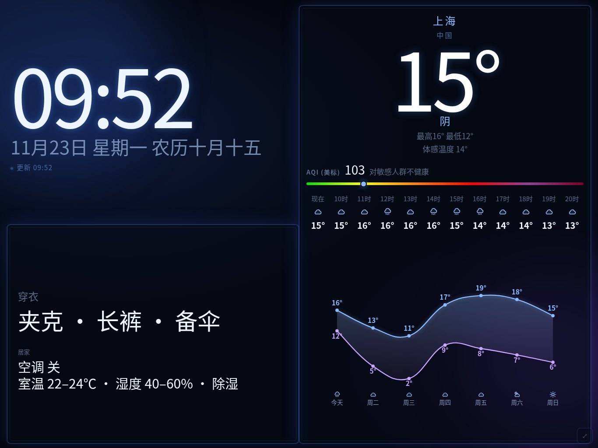
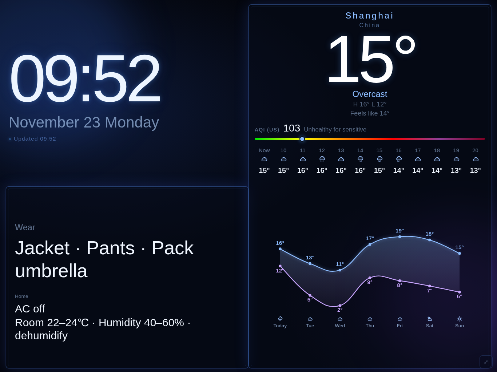
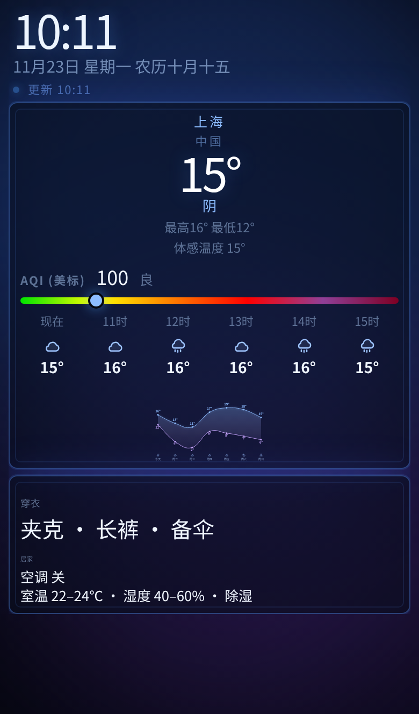

# 天气时钟大屏 · Weather Clock Dashboard

[English](README.md)

[](https://ywlbest-creator.github.io/weather-clock-dashboard/)

把任意一台能上网的旧设备——手机、平板、电脑或电视浏览器——变成一块全屏天气时钟：时间、天气、穿衣建议和居家提示。无需安装 App，用浏览器打开即可。单文件、无外部依赖。







---

## 功能

- 全屏时钟，与当前气温使用相同字号；日期和星期为大号字体（中文界面附农历）
- 当前天气、体感、空气质量（美标或欧标 AQI）、逐时预报
- 未来 7 天最高 / 最低气温曲线图（纯 SVG，无图表库）
- 一条通用穿衣建议（不出现人名）；可选居家建议（空调、取暖器、建议室温和湿度）
- 响应式布局：手机、平板、电脑、电视浏览器；横屏与竖屏均可使用，字号随屏幕缩放
- 尽量兼容旧版 iOS Safari 与旧版 Android Chrome（ES5 风格脚本、CSS 回退）
- 支持 [Wake Lock](https://developer.mozilla.org/docs/Web/API/Screen_Wake_Lock_API) 防息屏（不支持则自动忽略）；可点击右下角按钮全屏
- 天气约每 15 分钟自动刷新；时钟每秒更新
- 中 / 英界面完整双语：默认按 `navigator.language` 自动选择，也可用 `?lang=zh` / `?lang=en` 强制。摄氏 / 华氏单位可选

数据来自 [Open-Meteo](https://open-meteo.com/)。

---

## 位置如何确定

页面按下面的**优先顺序**选择地点，只采用其中第一种成功的方式：

1. **网址参数**（最高优先）
   - `?lat=31.23&lon=121.47`：直接使用经纬度；若同时写了 `?city=`，城市名仅用于显示。
   - 只有 `?city=Beijing`（或中文名，如 `?city=苏州`）：用 Open-Meteo 地理编码查出经纬度。
2. **浏览器定位**：网址里没有地点参数时，请求 `navigator.geolocation`。同意后按当前位置取天气，并用 Open-Meteo 反向地理编码显示地名；若反向查询不可用，则显示经纬度。
3. **默认城市**：用户拒绝定位、定位失败，或设备不支持定位时，使用页面顶部 `CONFIG` 里的默认城市（出厂为上海）。

首次打开且未带地点参数时，浏览器会询问位置权限，这是正常现象。

---

## 语言如何确定

页面内所有文字（日期星期、天气描述、穿衣 / 居家建议、标签）均为中英双语。

1. `?lang=zh` 或 `?lang=en` **强制**使用该语言。
2. 否则跟随 `navigator.language`（以及 `navigator.languages`）：以 `zh` 开头的语言标签使用中文，其他语言使用英文。
3. 若浏览器语言不可用，则使用 `CONFIG.lang`（`"zh"` 或 `"en"`）。

---

## 如何查看访问量

本说明顶部的徽章显示[在线页面](https://ywlbest-creator.github.io/weather-clock-dashboard/)被打开的次数，与页面使用的是同一套计数。

计数服务是 [Visitor Badge](https://visitor-badge.laobi.icu/)（`visitor-badge.laobi.icu`），免注册的公共计数，只保存一个页面 id 和数字，不收集个人信息。在线页用一次隐藏请求记数；若该请求失败，时钟和天气页面仍会照常工作。说明里的徽章带有 `query_only=true`，只看说明、不加次数。

Fork 之后可以这样处理：

- 在 `index.html` 里把 `CONFIG.counter` 设为 `false`，即可关闭计数（也可以同时从两份 README 中去掉徽章）。
- 或者把 `CONFIG.counterId` **以及** 两份 README 徽章里的 `page_id` 改成你自己的 id（例如 `yourname.weather-clock-dashboard`），从而单独计数。若只想统计在线页打开次数，请保留 README 徽章上的 `query_only=true`。

---

## 如何改配置

打开 `index.html`，在靠近文件开头的 `CONFIG` 对象里修改即可：

| 字段 | 含义 | 示例 |
| --- | --- | --- |
| `city` | 默认城市名（定位失败时使用，也用于显示） | `"Shanghai"` |
| `citySub` | 可选副标题，如区名 | `"Pudong"` 或 `""` |
| `lat` | 默认纬度 | `31.22222` |
| `lon` | 默认经度 | `121.45806` |
| `timezone` | [IANA 时区](https://en.wikipedia.org/wiki/List_of_tz_database_time_zones) | `"Asia/Shanghai"`、`"America/New_York"` |
| `lang` | 浏览器语言未知时的后备界面语言 | `"zh"` 或 `"en"` |
| `units` | 温度单位 | `"celsius"` 或 `"fahrenheit"` |
| `aqi` | 空气质量标准 | `"us"` 或 `"european"` |
| `homeAdvice` | 是否显示居家建议 | `true` / `false` |
| `refreshMinutes` | 天气刷新间隔（分钟） | `15` |
| `counter` | 是否统计在线页访问 | `true` / `false` |
| `counterId` | Visitor Badge 的 `page_id`（Fork 后请改成自己的） | `"ywlbest-creator.github.io.weather-clock-dashboard"` |

穿衣建议是一条通用建议，配置里没有家庭成员或人名。

改完后重新打开页面即可。若部署在 GitHub Pages，提交并推送后稍等片刻再刷新。

---

## 网址参数示例

参数会覆盖 `CONFIG` 中的对应项。地点参数的优先级见上文。

```
?city=Beijing
?city=东京
?lat=40.71&lon=-74.01
?lat=51.51&lon=-0.13&city=London
?lang=en
?lang=zh
?units=fahrenheit
?aqi=european
?home=0
?refresh=10
?tz=America/New_York
?city=New%20York&lang=en&units=f&aqi=us
```

| 参数 | 说明 |
| --- | --- |
| `city` | 城市名，将进行地理编码 |
| `lat`, `lon` | 经纬度 |
| `lang` | `zh` 或 `en`（强制界面语言） |
| `units` / `unit` | `celsius`（或 `c`）/ `fahrenheit`（或 `f`） |
| `aqi` | `us` 或 `european`（也可用 `eu`） |
| `home` | `0` / `false` / `off` 可关闭居家建议 |
| `refresh` | 刷新间隔（分钟） |
| `tz` / `timezone` | 时区，如 `Asia/Tokyo` |

---

## 穿衣建议规则

穿衣只显示**一条**通用建议，不含人名。判断依据是当天（晚上 18:00 之后改为次日）**早晨 5–8 点的最低气温**，以及降雨概率。

### 上装（按早间气温）

| 气温（℃） | 建议 |
| --- | --- |
| ≥ 28 | 短袖 |
| 22 – 27 | 薄长袖 |
| 15 – 21 | 薄外套 |
| 8 – 14 | 夹克 |
| 0 – 7 | 厚外套 |
| < 0 | 羽绒服 |

### 下装

| 气温（℃） | 建议 |
| --- | --- |
| ≥ 30 | 短裤 |
| 0 – 29 | 长裤 |
| < 0 | 加绒裤 |

### 配件

| 条件 | 建议 |
| --- | --- |
| 降雨概率 ≥ 40% | 带伞 |
| 降雨概率 ≥ 20%，或天气代码为雨 | 备伞 |
| 早间气温 < 0℃ | 帽手套 |

18:00 之后，标签会标出「明天」（或对应星期），建议按次日早晨计算。

---

## 居家建议规则

居家行根据**室外**气温和湿度估算，不读取室内传感器。

取 `min(当前气温, 夜间最低温)` 作为「地板温度」。18:00 之后的夜间最低温使用次日最低温。

### 空调与取暖器

| 条件 | 建议 |
| --- | --- |
| 当前室外气温 ≥ 28℃ | 空调 制冷 |
| 地板温度 ≤ 11℃ | 空调 制热 |
| 其他 | 空调 关 |
| （夜间且地板温度 ≤ 11℃）或地板温度 < 5℃ | 同时建议开取暖器 |

夜间指 22:00 至次日 05:30。

### 建议室温

| 条件 | 建议室温 |
| --- | --- |
| 空调制冷 | 26℃ |
| 空调制热，或室外 < 15℃ | 20–22℃ |
| 其他 | 22–24℃ |

### 建议湿度

目标湿度为 **40–60%**。

| 条件 | 额外提示 |
| --- | --- |
| 制热中且室外相对湿度 < 50%，或其他情况下 < 40% | 加湿 |
| 制热中且湿度 ≥ 85%，或其他情况下 > 70% | 除湿 |

若使用华氏显示，室温数字会换算为 °F，判断规则仍按摄氏计算。

---

## 在不同设备上使用（含如何常亮）

页面会尽量申请屏幕唤醒锁（Wake Lock）。不支持的浏览器会忽略，请同时在系统里关闭自动锁屏。点击右下角按钮可进入全屏（部分手机浏览器不提供网页全屏，请改用「添加到主屏幕」）。

### iPhone / iPad（Safari）

1. 用 Safari 打开页面。
2. 轻点分享按钮，选择「添加到主屏幕」，然后从主屏幕打开，即可隐藏浏览器工具栏。
3. 打开「设置 → 显示与亮度 → 自动锁定」，选「永不」（注意耗电；用完后改回去）。
4. 也可使用「引导式访问」把屏幕锁在此应用内。

iOS 对网页 Wake Lock 支持有限，请以系统「自动锁定」为准。

### Android 手机 / 平板（Chrome 等）

1. 用 Chrome 打开页面，菜单中选择「添加到主屏幕」或「安装应用」，再从主屏幕打开。
2. 打开系统「设置 → 显示 → 休眠 / 屏幕超时」，选较长时间或「永不」（名称因品牌而异）。
3. 部分机型可在开发者选项中打开「保持唤醒」。较新的 Chrome 在页面可见时通常支持 Wake Lock。

### 电脑（Windows / macOS / Linux）

1. 用 Chrome、Edge 或 Firefox 打开页面。
2. 按 `F11`（macOS 可用浏览器的「进入全屏」），或点击页面右下角全屏按钮。
3. 在系统电源设置中关闭「关闭屏幕 / 睡眠」，或把超时调长。
4. 只要标签页保持可见，较新的桌面浏览器一般会通过 Wake Lock 维持常亮。

### 智能电视 / 机顶盒浏览器

1. 在电视或盒子的浏览器中输入本页网址并打开。
2. 如浏览器提供全屏，请进入全屏；也可点击页面上的全屏按钮。
3. 在电视的「节能 / 休眠 / 自动关机」里关闭睡眠或把时间调长，否则电视可能自行息屏。
4. 保持该标签在前台。部分旧电视浏览器不支持 Wake Lock，必须改系统节能选项。

旧设备若样式稍有简化（例如没有发光动画或圆角渐变），时钟、天气和建议仍应可以使用。

---

## Fork 后开启 GitHub Pages

1. 打开本仓库，点击右上角 **Fork**，复制到你的账号下。
2. 如需改默认城市，编辑你仓库里的 `index.html` 顶部 `CONFIG`，提交更改。
3. 打开仓库 **Settings → Pages**。
4. **Source** 选择 **Deploy from a branch**；分支选 `main`，目录选 `/ (root)`，保存。
5. 等待一两分钟，站点地址为：

   `https://<你的用户名>.github.io/weather-clock-dashboard/`

6. 在设备浏览器中打开该地址。定位功能需要 HTTPS（GitHub Pages 已提供）。

也可以把 `index.html` 放到任意静态托管（NAS、局域网、Cloudflare Pages 等）。用 `file://` 直接打开时，浏览器可能拦截定位和部分网络请求，建议用本地或远程 HTTP(S) 访问。

---

## 数据来源与许可

- 天气、空气质量和地理编码来自 [Open-Meteo](https://open-meteo.com/)（[预报 API](https://open-meteo.com/en/docs)、[空气质量 API](https://open-meteo.com/en/docs/air-quality-api)、[地理编码 API](https://open-meteo.com/en/docs/geocoding-api)）。
- 请遵循 Open-Meteo 的使用条款与署名要求，保留对 Open-Meteo 的致谢。数据许可说明见：[Open-Meteo License](https://open-meteo.com/en/license)（通常以 CC-BY 方式署名即可）。
- 本项目源代码以 [MIT License](LICENSE) 发布。

---

## 常见问题

**定位被拒绝或一直不到位置怎么办？**  
这是正常情况。可以在网址后加 `?city=城市名` 或 `?lat=&lon=`，也可以修改 `CONFIG` 里的默认城市。拒绝定位后，页面会自动改用默认城市，不必再授权。

**天气数据不刷新？**  
确认设备已联网，并能访问 `api.open-meteo.com`。页面默认约每 15 分钟刷新一次（可用 `?refresh=` 或 `CONFIG.refreshMinutes` 修改）。请让页面保持在前台；从后台回到前台且间隔已超过刷新时间时，会立即再取一次。网络失败时会显示上次缓存，时间旁的状态会变成「缓存」并呈提示色。仍不更新时，请手动刷新浏览器。

**时钟不是当地时间？**  
时钟使用已解析地点的时区。用 `?city=` / 定位得到的地点一般会带上时区；如不正确，可用 `?tz=Asia/Tokyo` 覆盖，或在 `CONFIG.timezone` 中设置。

**旧手机看起来有点不一样？**  
这是为了兼容：不支持的 CSS（如 `clamp`、部分动画）会被忽略并回退到固定字号。如布局过紧，可把设备横过来，或用「添加到主屏幕」全屏查看。

**怎么看访问次数？**  
看本说明顶部的徽章，或打开带 `query_only=true` 的同一图片地址（见[如何查看访问量](#如何查看访问量)）。Fork 后若要停止计数，把 `CONFIG.counter` 设为 `false` 即可。
